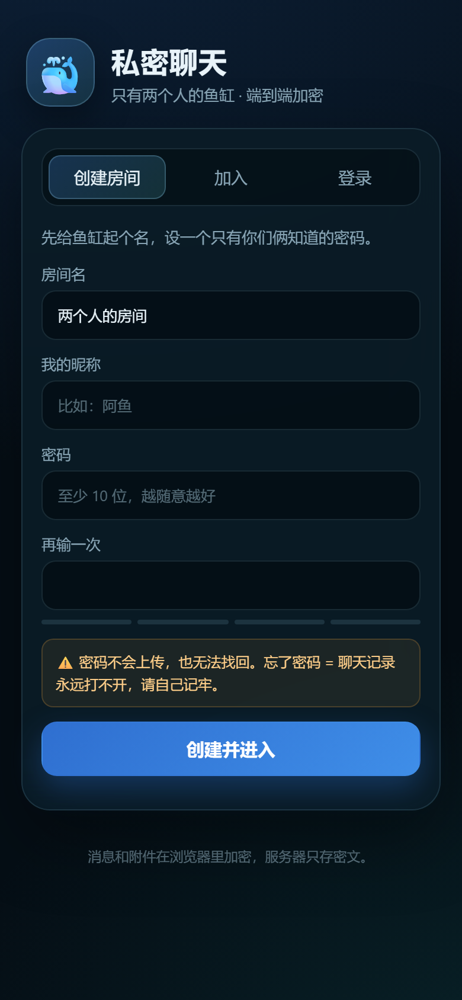
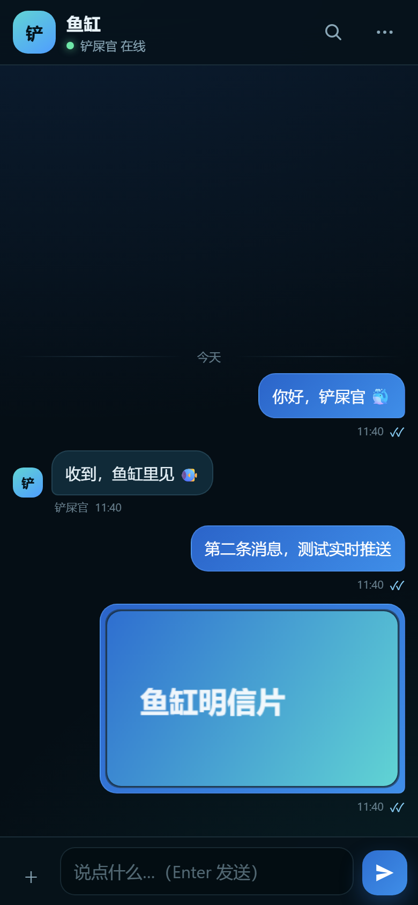
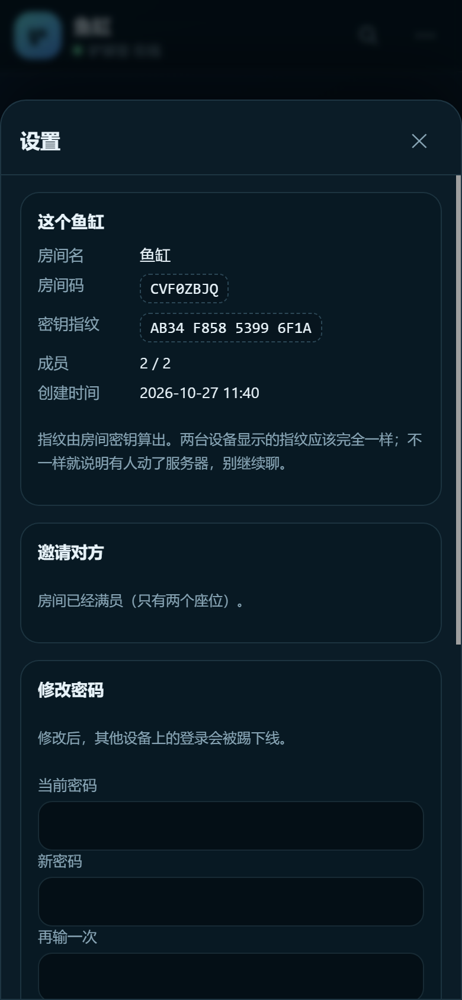

# 私密聊天 · 两个人的鱼缸

只供两个人使用的私密聊天网站。消息和附件在浏览器里用 **ChaCha20-Poly1305** 加密，
服务器只保存密文；聊天记录落在这台电脑的 SQLite 里；手机连同一个 Wi-Fi 就能用浏览器打开。

- 端到端加密：服务器、局域网抓包、云隧道都只能看到密文
- 只要两个人：一个房间最多两个成员，第二个人只能通过一次性邀请链接加入
- 本地保存：`data/chat.db` + `data/blobs/`，不经过任何第三方
- 记录可查：历史翻页、全文搜索（本地解密后搜）、导出 JSON
- 手机可用：响应式界面、暗色、PWA 清单、iOS 添加到主屏幕
- 零依赖部署：后端只用 Python 标准库 + SQLite

> 密码不在任何地方保存，也无法找回。**忘了密码 = 聊天记录永远打不开，请自己记牢。**

## 界面预览

<p>
  
  
  
</p>

---

## 一、五分钟跑起来

### 1. 启动

双击 `start.bat`（或右键 `start.ps1` → 使用 PowerShell 运行）。

它会：

1. 用本机 Python 启动服务（默认端口 `8787`）
2. 自动打开浏览器
3. 在窗口里打印本机和局域网地址

看到这样的输出就成功了：

```
本机访问: http://127.0.0.1:8787
局域网:   http://192.168.x.x:8787   (手机连同一 Wi-Fi 打开)
```

### 2. 创建房间

1. 打开页面，选「创建房间」
2. 填房间名、你的昵称、密码（至少 10 位）
3. 点「创建并进入」
4. 弹出的邀请链接，通过微信/当面等**私密渠道**发给另一个人

### 3. 让对方加入

对方在手机或电脑浏览器打开邀请链接，设置自己的昵称和密码，点「加入房间」。
邀请链接**只能用一次**，加入后立即失效。

### 4. 手机访问

1. 手机连和电脑**同一个 Wi-Fi**
2. 浏览器打开启动窗口里显示的 `http://192.168.x.x:8787`
3. 第一次可能在 Windows 防火墙弹窗里点「允许访问」
4. 没弹窗或连不上：双击 `allow-firewall.bat`，在 UAC 提示里点「是」。
   它只放行**同一局域网**的 TCP 8787（不向整个互联网开放）

如果换了 Wi-Fi 或路由器重启，IP 可能变化。重新看启动窗口打印的地址即可；
也可以在路由器里给电脑绑定固定 IP。

> 有些公司/学校 Wi-Fi 会隔离设备，手机和电脑互相访问不了。这种网络下可以：
> 让电脑连手机热点（同一热点通常能互通），或者用下面的 Tailscale 方案。

---

## 二、日常使用

### 登录（新设备 / 清过浏览器数据）

设置页能看到 8 位「房间码」。在登录页输入：房间码 + 昵称 + 密码。

### 本机解锁

为了安全，「锁定本机」会从浏览器里删掉聊天密钥，但保留登录状态。
下次打开会要求输入密码，密码只在本机参与解密，不会上传。

### 改密码

设置 → 修改密码。需要先输入当前密码；改完后其他设备上的登录会失效，
本机继续可用。改密码不会改变聊天密钥，历史记录照常能读。

### 搜索与导出

- 搜索：右上角 🔍，在本地解密后的消息里搜。更早的记录可以点「加载全部历史再搜索」
- 导出：设置 → 导出聊天记录，得到一个明文 JSON（含房间、成员、全部消息）。
  **导出的文件是明文，请自己收好，不要随手发人。**

### 邀请链接长什么样

```
http://192.168.x.x:8787/#/join?r=<房间ID>&c=<一次性邀请码>&k=<房间钥匙>
```

`#` 后面的部分不会发送给服务器，所以服务器看不到房间钥匙。
但链接本身等于钥匙，谁拿到谁就能进（且只能用一次）。只经私密渠道传递。

---

## 三、安全设计

### 加密链路

1. 创建房间时，浏览器生成 32 字节随机「房间主密钥」
2. 密码经 **PBKDF2-HMAC-SHA256（20 万次）** 派生两把密钥：
   - `authKey`：登录认证
   - `wrapKey`：包裹主密钥
3. 服务器只保存：`authKey`（相当于密码验证器）、用 `wrapKey` 加密后的主密钥
4. 每条消息用主密钥派生的消息密钥做 **ChaCha20-Poly1305**，AAD 绑定房间、发送者、类型、消息 ID
5. 附件同样单独加密，文件名和 MIME 只存在于消息密文里

服务器能看到：谁在什么时候发了多长的消息、附件多大、房间有几个成员。
服务器看不到：密码、主密钥、消息内容、附件内容、文件名。

### 密钥指纹

设置页有一串「密钥指纹」（由主密钥算出）。两台设备应该完全一样。
如果某天突然变了，说明服务器上的密钥包裹被换过，别继续聊，先核对。

### 防爆破

- 登录失败按房间 + 昵称限速，连续错 8 次锁 5 分钟
- 登录接口统一返回「房间码、昵称或密码不正确」，避免枚举昵称
- 每个挑战一次性、5 分钟过期，登录用 HMAC 挑战应答，不传密码
- 全站 CSP、无内联脚本、消息用 `textContent` 渲染，防 XSS
- 会话 Cookie：HttpOnly + SameSite=Strict；所有写请求要自定义头，防 CSRF

### 威胁模型（重要）

- ✅ 防：服务器数据库被拷走、局域网抓包、云隧道运营商偷看 → 只能拿到密文
- ✅ 防：陌生人扫端口猜密码 → 限速 + 强密码 + 一次性邀请
- ⚠️ 防不了：服务器被完全控制后，攻击者可以换掉前端 JS。这时任何网页加密都救不了，
  只能靠密钥指纹发现「密钥被换」，或者换一台可信设备
- ⚠️ 防不了：密码太弱被离线爆破。PBKDF2 20 万次能拖慢，但请用长密码
- ⚠️ 局域网 HTTP 下，首次加载页面时可能被同网段主动中间人替换 JS。
  在不可信 Wi-Fi（咖啡店、公司）建议走 HTTPS 隧道，见下一节

---

## 四、手机 / 外网访问

### 方案 A：同一个 Wi-Fi（最简单）

就是上面的 `http://192.168.x.x:8787`。不用装任何东西。

限制：HTTP 下浏览器不提供 Service Worker / 完整 PWA 安装，但可以

- iOS Safari：分享 → 添加到主屏幕（生成快捷方式，可全屏）
- Android Chrome：菜单 → 添加到主屏幕（快捷方式）

### 方案 B：Tailscale（推荐，外网也能用，HTTPS）

1. 电脑和手机都装 [Tailscale](https://tailscale.com/)，登录同一个账号
2. 电脑上执行：

   ```powershell
   tailscale serve --bg 8787
   ```

3. 手机打开 Tailscale 给出的 `https://<机器名>.<tailnet>.ts.net/` 地址

这样只有你自己的设备能访问，不暴露公网，还是 HTTPS（可以装 PWA、Service Worker 可用）。
Tailscale 只转发加密流量，聊天内容仍是端到端密文。

### 方案 C：Cloudflare Tunnel（想发给别人/公网 HTTPS）

```powershell
cloudflared tunnel --url http://127.0.0.1:8787
```

得到一个 `https://xxx.trycloudflare.com` 地址。适合临时用；长期用建议命名隧道 + 访问策略。
Cloudflare 能看到流量元数据，但内容仍是密文。

> 不建议直接把 8787 端口映射到公网。HTTP 明文传输页面，首次加载有被替换风险。

---

## 五、数据、备份与迁移

```
private-chat/
  data/
    chat.db          # 房间、成员、消息密文、附件元数据、会话、审计
    blobs/           # 附件密文
```

- 备份：先停止服务（Ctrl+C），把整个 `data/` 文件夹复制走
- 迁移：把 `private-chat/` 整个目录复制到新电脑，装好 Python，双击 `start.bat`
- 清空：停止服务，删除 `data/`（所有聊天记录和房间都会消失，无法恢复）
- 导出：设置 → 导出聊天记录（明文 JSON，用于长期归档）
- 服务器上的 `data/chat.db` 里消息是密文；没有密码，拿到数据库也读不出内容

> 换电脑后，浏览器里的本地密钥不会跟着走。需要用「房间码 + 昵称 + 密码」重新登录，
> 服务器会用密码解开主密钥。所以**密码必须记住**。

---

## 六、开机自启（可选）

双击 `install-autostart.bat`，会在当前用户的「启动」文件夹里放一个 `PrivateChat.vbs`，
登录 Windows 后静默启动服务（不弹黑窗口，不需要管理员权限）。

- 取消：双击 `uninstall-autostart.bat`
- 注意：自启用的是 `pythonw.exe`，没有控制台窗口，日志看不到；
  出问题就先取消自启，用 `start.bat` 前台跑一遍看报错

---

## 七、目录结构

```
private-chat/
  app/
    server.py              # 后端：HTTP + SQLite + SSE（Python 标准库）
    web/
      index.html           # 单页界面
      app.js               # 前端逻辑
      crypto.js            # 纯 JS 加密原语（SHA-256/HMAC/PBKDF2/ChaCha20-Poly1305）
      style.css
      sw.js                # Service Worker（HTTPS 下生效）
      manifest.webmanifest
      icons/
  tests/
    test_crypto.mjs        # 加密原语测试（对照 Node/OpenSSL + RFC 向量）
    e2e.mjs                # 真实 HTTP 协议端到端测试
    dom.mjs                # jsdom 前端主流程测试
    dom-flows.mjs          # 邀请加入 / 登录 / 解锁流程测试
    browser.mjs            # 真实 Edge 测试（需要非沙箱环境）
    run-all.ps1            # 一键跑上面四组测试
  docs/                    # README 用的界面截图
  tools/
    make_icons.py
    allow-firewall.ps1
    install-autostart.ps1
    uninstall-autostart.ps1
  data/                    # 运行时生成，已被 .gitignore 忽略
  start.bat / start.ps1
  allow-firewall.bat
  install-autostart.bat / uninstall-autostart.bat
```

---

## 八、开发与测试

后端零第三方依赖；前端测试需要 Node 和 jsdom（仅开发用）。

```powershell
# 安装前端测试依赖（只需一次）
pnpm install

# 一键跑全部测试（需要 Node 18+；本机可用 DSH 自带的 node）
powershell -NoProfile -ExecutionPolicy Bypass -File tests/run-all.ps1

# 也可以单独跑：
node tests/test_crypto.mjs
node tests/e2e.mjs
node tests/dom.mjs
node tests/dom-flows.mjs

# 真实浏览器测试（可选；需要能启动 Edge）
node tests/browser.mjs
```

`tests/e2e.mjs` 和两个 DOM 测试会自己起临时服务（随机端口）并在结束后清理，
不会动 `data/` 里的正式数据。

### 已验证

本项目已经在本机跑过：

- 加密原语 **23 项**：SHA-256 / HMAC / PBKDF2 对照 Node OpenSSL，AEAD 对照 RFC 8439 官方向量
- 真实 HTTP 协议 **20 项**：创建房间、邀请、加入、登录、消息、附件、SSE、改密码、审计、历史分页、静态资源
- jsdom 前端 **11 项**：创建/发消息/搜索/设置，以及邀请加入、房间码登录、本机解锁
- 真实 Edge（两台“设备”）**16 项**：双向实时消息、已读、在线状态、正在输入、加密图片、刷新恢复、改密码、锁定解锁、无控制台报错

浏览器测试的截图在 `tests/shots/`（下次运行会覆盖）。

### 端口 / 参数

```powershell
python app/server.py --port 8787 --data-dir data
python app/server.py --help
```

---

## 九、常见问题

**手机打不开？**
- 确认电脑和手机同一个 Wi-Fi
- 确认用的是启动窗口里那个 `192.168.x.x` 地址，不是 `127.0.0.1`
- 双击 `allow-firewall.bat` 放行 8787
- 公司/学校 Wi-Fi 可能隔离设备，换手机热点试试

**忘了密码？**
没有任何办法恢复。只能重新建房间，历史记录保留在旧房间里但读不出来。

**邀请链接过期/被用了？**
设置 → 邀请对方 → 重新生成（一次性，旧链接立即失效）。

**能加第三个人吗？**
不能，房间固定两个座位。要多人请另建房间。

**能撤回/删除单条消息吗？**
当前版本没有。服务器保存的是密文，但删消息需要两端同步，后续版本再加。

**为什么没有消息通知？**
浏览器通知需要 HTTPS + 用户授权，当前版本没做。手机可以先添加到主屏幕。

**支持语音/视频吗？**
不支持，只有文字、图片和文件（单个 ≤ 12MB）。

---

## 十、设计取舍

- 纯 JS 加密而不是 WebCrypto：手机通过局域网 HTTP 访问时 `crypto.subtle` 不可用；
  纯 JS 实现让「不装证书、不配 HTTPS」也能端到端加密
- 服务器只存密文：代价是服务器无法搜索/统计内容，搜索必须由客户端解密后做
- 共享房间主密钥、每人独立密码：两个人共享同一把钥匙，但登录凭据各自独立，
  改密码不影响对方，也不会泄露聊天密钥
- 邀请链接携带钥匙：这是最顺手的加法；代价是链接要私密传递、只能用一次

---

## 许可

个人使用随意。没有 warranty，重要聊天请自己做好导出备份。
